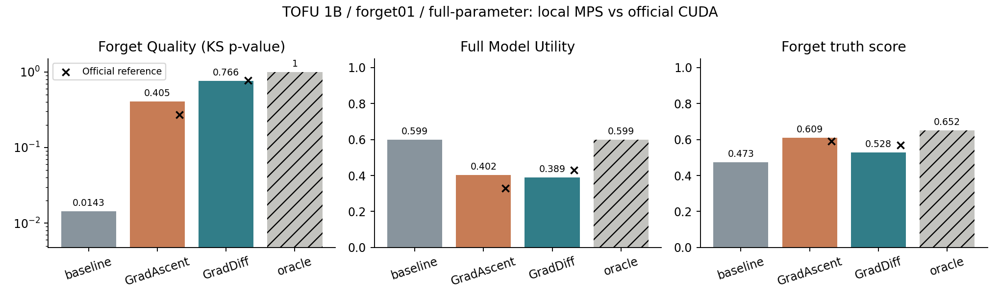

# LLM Unlearning: Forgetting, Utility, and Robustness

MSBD 5018, Fall 2026. A four-member course project on selective forgetting, retained knowledge, and robustness to changed prompts. **Built with Llama.**

We reproduce a focused **OpenUnlearning / TOFU / Llama-3.2-1B-Instruct / forget01 / GA-GD** setting, first on a 16 GB Mac and then on a Dell CUDA laptop. All formal training uses **1,235,814,400 parameters**, without LoRA. **Phase two is complete and verified:** the CUDA baseline, GA/GD seed-0 controls, and six additional weight/seed runs have complete evaluation records. New methods and prompt-robustness inference remain future work.

本项目对 **OpenUnlearning / TOFU / Llama-3.2-1B-Instruct / forget01 / GA-GD** 进行有限范围复现，先在 16 GB Mac 上执行，再扩展至戴尔 CUDA 笔记本。正式训练使用全部 **1,235,814,400 个参数**，不使用 LoRA。**第二阶段已完成并通过核验：**CUDA 起点、GA/GD 种子 0 对照及六组新增权重／种子实验均有完整评价记录。新方法与提示鲁棒性推理仍待执行。

## 阅读入口 / Start here

- **[第二阶段结果与组内交接 / Phase-two results and handoff](docs/PHASE2_RESULTS.md)** · [实验矩阵与验收 / Execution and acceptance](docs/PHASE2_STATUS.md)
- [CUDA 环境与命令 / CUDA workflow](docs/CUDA_RUNNING.md) · [戴尔与 Mac 对比 / Dell versus Mac](docs/DELL_VS_MAC.md)
- [逐次结果 / Every run](study/phase2/results.csv) · [三种子汇总 / Seed summary](study/phase2/seed-summary.csv) · [跨实验核验 / Batch audit](study/phase2/audit.json)
- **[英文一页提案](output/pdf/MSBD5018_Group_Project_Proposal.pdf)** · [中文一页提案](output/pdf/MSBD5018_Group_Project_Proposal_中文.pdf)
- **[项目方案与进度](docs/RESEARCH_PLAN.md)**：研究问题、方法比较、提示鲁棒性、四人分工及完成边界。
- [项目讲解](reproduction_full/项目讲解.md) · [复现协议](reproduction_full/复现协议.md)
- **[正式实验结果](reproduction_full/实验结果.md)** · [机器可读汇总](reproduction_full/summary.json)
- [详细运行说明](docs/RUNNING.md) · [协作约定](CONTRIBUTING.md)

## CUDA weight and seed results / CUDA 权重与种子结果

The Dell completed nine full evaluations, each with **657 questions**. Eight formal training runs each completed **10 optimizer updates / 320 sample visits / eight data passes**, saved full checkpoints, and passed fresh-process reload checks. Individual CPU verification and the cross-run audit passed; all same-seed comparisons have matching sampling. Mac runs remain separate.

戴尔已完成九组完整评估，每组 **657 题**。八组正式训练均完成 **10 次优化器更新／320 次样本访问／8 遍数据**，保存完整检查点并通过新进程重载检查。单组 CPU 核验及跨实验检查均通过，同种子比较的采样一致。Mac 结果单独保留。

| CUDA setting / CUDA 设置 | FQ | MU |
|---|---:|---:|
| Baseline, seed 0 / 起点，种子 0 | 0.0143 | 0.5991 |
| GA, seeds 0/1/2 / 三个种子 | 0.4626 ± 0.1005 | 0.3671 ± 0.0442 |
| GD, seeds 0/1/2 / 三个种子 | 0.6410 ± 0.1082 | 0.3787 ± 0.0106 |

GA/GD entries are mean ± sample standard deviation, n=3; GD alpha=gamma=1. GA has higher MU at seed 0, while GD has higher MU at seeds 1 and 2. The observed average favors GD slightly with less variation, but this does not establish a general advantage. FQ is a KS-test p-value, not accuracy or a percentage forgotten; its mean is descriptive, not a combined significance test. MU combines nine non-forget components and is not overall accuracy.

GA/GD 为均值 ± 样本标准差，n=3；GD alpha=gamma=1。seed 0 下 GA 的 MU 更高，seed 1、2 下 GD 更高。观测均值略偏向 GD，且 GD 波动较小，但不能据此证明普遍优势。FQ 是 KS 检验 p 值，不是准确率或遗忘百分比，均值仅作描述，不是合并后的显著性检验。MU 综合九项非遗忘分量，不是整体正确率。

| GD retain weight alpha, seed 0, gamma=1 / GD 保留权重 | FQ | MU |
|---|---:|---:|
| 0.5 | 0.1650 | 0.2564 |
| 1 | 0.5786 | 0.3905 |
| 2 | 0.1650 | 0.5235 |

These three observed weight points are not a continuous trade-off curve. Equal FQ p-values do not imply equal checkpoints or answer distributions. Every run and its evidence are in the [complete report](docs/PHASE2_RESULTS.md).

三个已观测权重点不构成连续权衡曲线。相同 FQ p 值不代表检查点或回答分布相同。全部实验及证据见[完整报告](docs/PHASE2_RESULTS.md)。


## Historical Mac results / 原 Mac 结果

The following frozen seed-0 records are preserved from the Mac. They are not pooled with CUDA runs as additional seeds. Historical research/task documents describe the earlier planning state; current execution status is in the phase-two report above.

以下为冻结保留的 Mac 种子 0 记录，不与 CUDA 混合作为新增种子。历史研究／任务文档记录早期规划，当前执行进度以上方第二阶段报告为准。

| 本地模型 | Forget Quality | Model Utility |
|---|---:|---:|
| 未遗忘起点 | 0.0143 | 0.5993 |
| Gradient Ascent (GA) | 0.4046 | 0.4019 |
| Gradient Difference (GD) | 0.7659 | 0.3887 |

每组评价相同的 **657 题**：40 遗忘、400 保留作者、100 真实作者及 117 世界知识。训练为 seed 0，各 10 次优化器更新。GA/GD 使用相同的数据抽取。FQ 是 KS 检验 p 值，**不是准确率或遗忘百分比**；MU 是九项非遗忘分数的调和平均值。官方 retain-only 参照来自公开逐题记录，未在本地重训。

GD 的三个保留作者分数略优于 GA，但部分其他知识分数下降，总体 MU 更低。现有三个点不是完整权衡曲线，单个种子不能支持稳定优劣结论。



## 不用 GPU 查看与核验 / Review without a GPU

只需 Python 3，不下载模型、不重新训练：

```sh
python3 verify_results.py
python3 -m http.server 8766 --bind 127.0.0.1 --directory reproduction_full
```

打开 `http://127.0.0.1:8766/viewer.html`，查看本地三组与官方参照的逐题回答。页面展示保存的实际记录，不是实时模型推理。

CUDA raw answers and scores are under `study/runs/<run-id>/evaluation/evaluation.json`, with `cpu_verification.json` for each run and `study/phase2/audit.json` for the batch. `verify_cuda_run.py` and `audit_phase2_cuda.py` perform CPU verification, including actual checkpoint hashes, when matching local full checkpoints are present. Git contains the saved records and reports, not the CUDA checkpoint files. No CUDA checkpoint release is claimed. To regenerate figures, install `requirements-report.lock` in a separate Python environment and run `report_phase2_cuda.py`.

CUDA 逐题回答及分数位于 `study/runs/<run-id>/evaluation/evaluation.json`，每组附 `cpu_verification.json`，批次核验见 `study/phase2/audit.json`。本地存在对应完整检查点时，`verify_cuda_run.py` 和 `audit_phase2_cuda.py` 可在 CPU 上复核记录及实际检查点哈希。Git 包含保存记录与报告，不包含 CUDA 检查点文件，此处不宣称已发布 CUDA 检查点包。重新绘图时，在独立 Python 环境安装 `requirements-report.lock`，再运行 `report_phase2_cuda.py`。

CUDA setup and fresh-run commands are in [CUDA_RUNNING.md](docs/CUDA_RUNNING.md). The validated Dell has an **RTX 4060 Laptop GPU with 8 GB VRAM and 16 GB system RAM**, using BF16 weights and dense FP32 optimizer states on CPU/disk. Entry points support method, seed, GD alpha/gamma, and isolated run IDs. Exact configuration/source signatures protect completed evidence. After a Git commit changes, use CPU verification for old records and fresh IDs for new training.

CUDA 环境与新实验命令见 [CUDA_RUNNING.md](docs/CUDA_RUNNING.md)。已验证戴尔为 **RTX 4060 Laptop、8 GB 显存、16 GB 系统内存**，采用 BF16 权重和 CPU／磁盘上的稠密 FP32 优化器状态。入口支持方法、种子、GD alpha/gamma 和独立实验编号，配置及源码签名保护已完成证据。Git 提交改变后，旧记录使用 CPU 核验，新训练使用新编号。

## Mac 上重跑 / Reproduce on Mac

```sh
bash setup_full.sh
.venv/bin/python run_full_experiment.py
```

需要 Apple Silicon MPS、Python 3.12、`uv`、网络和磁盘空间。原 Mac 为 M4 MacBook Air、16 GB 内存；建议至少 30 GB 可用磁盘。基座约 2.47 GB，优化器临时状态约 14.83 GB。CPU/磁盘状态及依次反向传播降低内存压力，但不保证与原 CUDA 轨迹逐位一致。戴尔 Windows/CUDA 的独立验证与新结果见上方链接。

仓库带有已完成结果，直接运行会核验已有缓存。若要**全新训练**，先在本地将 `reproduction_full/runs/` 和 `reproduction_full/calibration/` 移至备份目录，保留配置、源码快照及官方参考，再执行入口。缓存重载不算新训练。

已训练 GA/GD 的无损检查点包放在本仓库 **Releases**，不进入 Git 历史。下载后在仓库根目录解压，按包内说明恢复；固定基座仍需安装脚本下载。它们不是 LoRA 适配器，恢复得到完整模型。版本附 SHA256 校验文件。

## 后续研究 / Planned extensions

1. **已完成** GA/GD 多种子与 GD 保留权重对照；后续继续分析九个 MU 分量及真实回答。
2. 优先验证 SimNPO，再验证需要参照模型的 NPO；RMU 为可选第五方法，另列参数和资源预算。**这些新方法尚无本地训练结果。**
3. 提示变化压力测试：40 遗忘题和 40 保留对照，每题四类提示，共每模型 320 次生成。测试集和运行入口已准备，**尚无新增推理结果**。

```sh
python3 build_robustness_suite.py
.venv/bin/python run_original.py evaluate_robustness.py --stage baseline --limit 5
```

先以每领域 5 题检查运行；完整测试去掉 `--limit 5`，对 baseline、GradAscent、GradDiff 使用同一设置。结果另存 `study/robustness/runs/`，不覆盖原评价。答案重合度只用于筛查，是否恢复事实须人工复核。详见[完整方案](docs/RESEARCH_PLAN.md)及[状态配置](study/plan.json)。

## 来源与范围 / Attribution and scope

基于 [TOFU](https://arxiv.org/abs/2401.06121) 与 [OpenUnlearning](https://arxiv.org/abs/2506.12618)。上游方法及评价快照位于 `open-unlearning-original/`，固定版本见 `reproduction_full/source-manifest.json`。Mac/CUDA 资源适配、受控权重与种子实验、核验、分析和提示测试设计为本项目工作，不将已有算法宣称为原创。

源码、数据、模型的来源和许可见 [THIRD_PARTY.md](THIRD_PARTY.md) 及 `LICENSES/`。基座权重、环境、缓存、旧 LoRA 和历史失败运行不上传本仓库。近似行为遗忘不代表知识不可恢复，也不覆盖整个框架的所有模型、方法或攻击基准。
