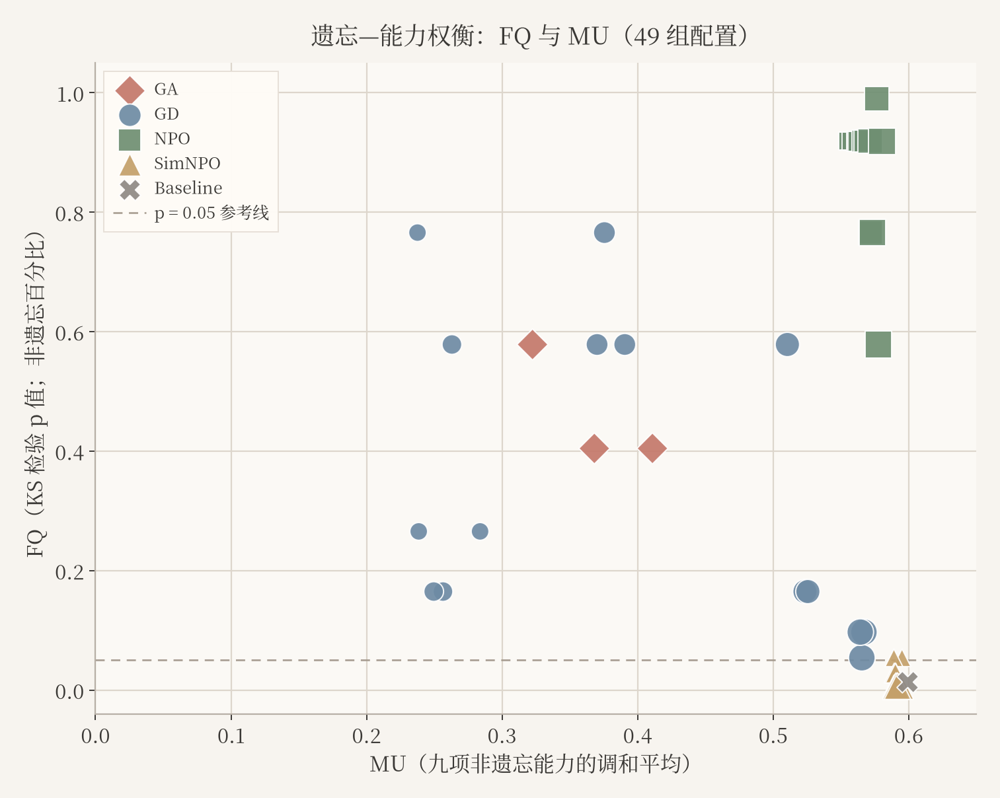

# LLM Unlearning: Forgetting, Utility, and Robustness

**English** | [简体中文](README.zh-CN.md)

**MSBD 5018 · Group 36 · Fall 2026 · Built with Llama**

A reproducible study of targeted forgetting, retained utility, and prompt-based fact recovery using **TOFU forget01**, **OpenUnlearning**, and **Llama-3.2-1B-Instruct**. We compare GA, GD, NPO, and SimNPO under a shared resource-constrained protocol. The algorithms are upstream methods; this repository contributes execution adaptations, verification, controlled experiments, and analysis.

[Research report](docs/RESEARCH_REPORT.md) · [Evaluation and figures](docs/evaluation/report/evaluation_metrics_and_results.md) · [Reproduce](docs/REPRODUCIBILITY.md) · [Data and annotations](docs/DATA_AND_ANNOTATIONS.md) · [Contributions](docs/TEAM_PROGRESS.md)

## Study at a glance

| Item | Released evidence |
|---|---|
| Model | Fixed TOFU-trained Llama-3.2-1B-Instruct; all 1,235,814,400 parameters trainable, no LoRA |
| Methods | GA, GD, NPO, SimNPO, plus one fixed Baseline |
| Experiment grid | **48 training runs · 49 complete evaluations · 657 questions per evaluation** |
| Variation | Seeds 0/1/2; five retain weights for GD, NPO, and SimNPO |
| Prompt study | **15,680 responses** across four prompt families |
| Annotation delivery | **4,508 labels**: 3,920 forget answers and 588 retain spot checks; predominantly AI-assisted |
| Figures | Six main figures and two supplementary figures; PNG, PDF, SVG and plotting source |
| Evidence status | Full grid and evaluation materials delivered; independent double-human adjudication is not established |

Updated **8 November 2026**. This page reflects the latest evaluation and figure delivery, rather than earlier planning documents.

## Research background

Deleting a training record does not itself update a trained model, and failure to answer one direct question is limited evidence of forgetting. Our [background and related work](docs/RESEARCH_REPORT.md#1-research-questions-and-context) explains why we evaluate forgetting, retained utility, and prompt-based fact recovery together. It connects SISA, TOFU, NPO, SimNPO, RMU/WMDP, robust unlearning tests, and OpenUnlearning to our choice of four post-training objectives and a resource-constrained experimental grid. The expanded discussion and [seven references](THIRD_PARTY.md#research-references) incorporate the research background developed for Part 1 of the group presentation.

## Main findings

At default coefficients, results are mean ± sample standard deviation across three seeds. Baseline is a single fixed evaluation.

| Method | Forget Quality (KS p-value) | Model Utility |
|---|---:|---:|
| Baseline | 0.014302 | 0.599108 |
| GA | 0.462592 ± 0.100466 | 0.367142 ± 0.044240 |
| GD | 0.641044 ± 0.108156 | 0.378684 ± 0.010584 |
| NPO | 0.918805 ± 0.000000 | 0.567208 ± 0.000786 |
| SimNPO | 0.005513 ± 0.002161 | 0.592088 ± 0.002791 |



- **NPO** attains high measured FQ with moderate utility loss within this grid.
- **SimNPO** retains utility near Baseline but has low measured FQ under the tested budget and coefficients.
- **GD** gains utility as the retain weight increases, while forgetting and seed variation are not monotonic.
- **Alternative prompts** recover some target facts in the annotated subset. Conditional counts are Contextual 16/328, Instruction challenge 21/324, and Role-play 35/320. These are descriptive, predominantly AI-assisted labels with explicit eligibility rules and exclusions, not full-grid human accuracy.

FQ is **not a forgetting percentage**; MU is **not overall accuracy**; ROUGE is **not factual correctness**. A high KS p-value does not prove complete erasure. Methods are not matched at equal achieved forgetting, and results do not establish a universal ranking. See [definitions, denominators, and limitations](docs/RESEARCH_REPORT.md).

## Experiment coverage

| Setting | Seeds | Retain weight α | Training runs | Evaluations | Prompt answers |
|---|---|---|---:|---:|---:|
| Baseline | Fixed | Not applicable | 0 | 1 | 320 |
| GA | 0, 1, 2 | No retention term | 3 | 3 | 960 |
| GD | 0, 1, 2 per weight | 0.25, 0.5, 1, 2, 4 | 15 | 15 | 4,800 |
| NPO | 0, 1, 2 per weight | 0.25, 0.5, 1, 2, 4 | 15 | 15 | 4,800 |
| SimNPO | 0, 1, 2 per weight | 0.25, 0.5, 1, 2, 4 | 15 | 15 | 4,800 |
| **Total** | | | **48** | **49** | **15,680** |

Formal runs use ten optimizer updates and 320 sample visits. The complete grid reuses ten runs and adds 38. NPO/GD use γ=1; NPO β=0.1; SimNPO γ=0.125, β=4.5, δ=0. The imported retain-only Oracle was not trained locally.

[All 49 results](study/phase3/grid-20261029/all-49-settings.csv) · [Three-seed summaries](study/phase3/grid-20261029/three-seed-summary.csv) · [Per-question paired prompt changes](study/phase3/grid-20261029/paired-prompt-proxies.csv)

## Verify the published evidence

From a disposable checkout, with Python 3 and no model download or GPU:

```sh
python3 verify_results.py
python3 verify_phase3_delivery.py
python3 verify_phase3_grid_delivery.py --require-visual
```

These check saved records and may rewrite audit JSON. They do not retrain a model or certify independent human annotation. The frozen blank-package checks are separate from C's later completed workbook. Follow the [reproduction guide](docs/REPRODUCIBILITY.md) for figure rebuilding and the pinned GPU workflow.

## Repository guide

| Location | Purpose |
|---|---|
| [docs/](docs/README.md) | English and Chinese research documentation |
| [docs/evaluation/](docs/evaluation/README.md) | Full evaluation chapter, figures, annotation workbook, derived tables |
| [study/phase3/grid-20261029/](study/phase3/grid-20261029/) | Complete grid, responses, summaries, provenance, audit records |
| [study/runs/](study/runs/) | Run-specific configurations, outputs, and verification records |
| [scripts/](scripts/) | Figure and document generation sources |
| [open-unlearning-original/](open-unlearning-original/) | Pinned upstream code and original license |
| [artifacts/](artifacts/) | Pinned data/reference metadata; model weights are downloaded separately |
| [reproduction_full/](reproduction_full/) | Historical reproduction evidence, preserved for audit |

Current research documentation defaults to English; each principal page links to its Chinese counterpart. Original data, source snapshots, supplied course documents, and historical experiment records retain their original language and paths to preserve provenance.

## Contributors

| Member | Account | Contribution |
|---|---|---|
| A | [zeliang369-del](https://github.com/zeliang369-del) | Experimental infrastructure, GPU adaptation and repairs, experiment execution, validation, integration |
| B | [caojie1126-loryhbox](https://github.com/caojie1126-loryhbox) | SimNPO/NPO implementations, training adapters, reference-cache design and tests |
| C | [top-linan](https://github.com/top-linan) | Evaluation materials, completed annotation workbook, analysis, and revised final figures with reproducible exports |
| D | [xing-pangdingyu](https://github.com/xing-pangdingyu) | Initial figure preparation and submission of the evaluation package |

Authorship follows the clarified team contributions. PR upload history is not used as a substitute for authorship: C prepared the evaluation materials and refined D's initial figures. See [contribution provenance](docs/TEAM_PROGRESS.md).

## Sources, citation, and reuse

Built on TOFU, OpenUnlearning, NPO, and SimNPO. Cite this repository by title, URL, and the exact commit used, alongside the upstream papers in [sources and notices](THIRD_PARTY.md). This is a course research repository, not a claim of a peer-reviewed publication. Model terms, framework licensing, and data notices are distinct; see [LICENSES/](LICENSES/). Model weights, caches, environments, and credentials are not distributed here.
