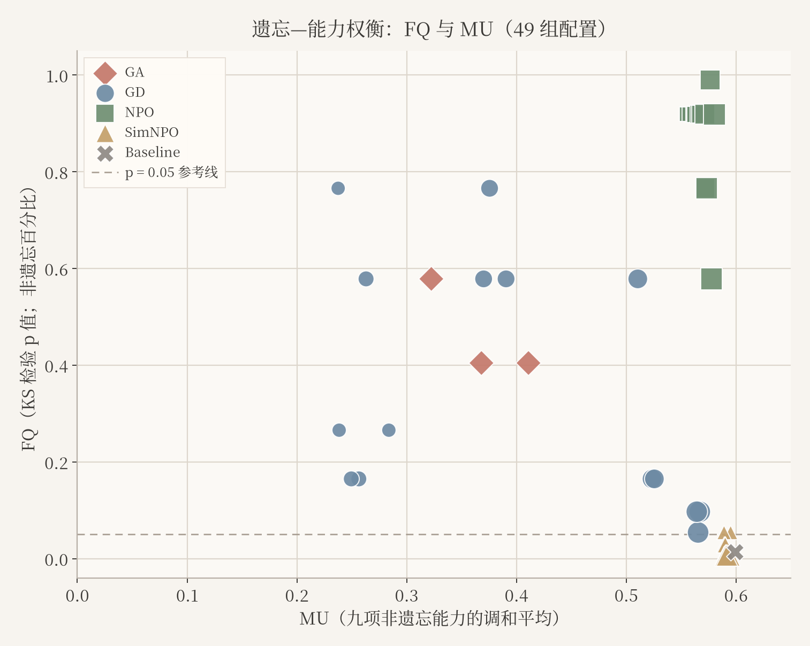

# 大模型遗忘学习：遗忘效果、能力保留与鲁棒性

[English](README.md) | **简体中文**

**MSBD 5018 · 第 36 组 · 2026 年秋季 · Built with Llama**

基于 **TOFU forget01**、**OpenUnlearning** 和 **Llama-3.2-1B-Instruct**，研究目标知识遗忘、模型效用保留与提示变化下的事实恢复。在统一且受资源约束的协议下比较 GA、GD、NPO 和 SimNPO。算法来自上游，本仓库贡献是执行适配、核验、受控实验和分析。

[研究报告](docs/RESEARCH_REPORT.zh-CN.md) · [评估与图表](docs/evaluation/report/evaluation_metrics_and_results.zh-CN.md) · [复现指南](docs/REPRODUCIBILITY.zh-CN.md) · [数据与标注](docs/DATA_AND_ANNOTATIONS.zh-CN.md) · [成员贡献](docs/TEAM_PROGRESS.zh-CN.md)

## 研究概览

| 项目 | 已交付证据 |
|---|---|
| 模型 | 固定 TOFU 训练版 Llama-3.2-1B-Instruct；全部 1,235,814,400 参数可训练，未使用 LoRA |
| 方法 | GA、GD、NPO、SimNPO，另设一个固定 Baseline |
| 实验矩阵 | **48 次训练 · 49 组完整评测 · 每组 657 题** |
| 对照变量 | 种子 0/1/2；GD、NPO、SimNPO 各五档保留权重 |
| 提示研究 | 四类提示，共 **15,680 条回答** |
| 标注交付 | **4,508 条标签**：3,920 条遗忘回答、588 条保留集抽查；主要采用 AI 辅助 |
| 图表 | 六张主图、两张补充图；含 PNG、PDF、SVG 和绘图源码 |
| 证据状态 | 完整矩阵与评估材料已交付；尚无已完成双人独立人工裁决的证据 |

更新于 **2026 年 11 月 8 日**，按最新评估和图表交付整理。

## 主要发现

默认系数下，结果为三个种子的均值 ± 样本标准差；Baseline 为一次固定评价。

| 方法 | 遗忘质量 FQ（KS p 值） | 模型效用 MU |
|---|---:|---:|
| Baseline | 0.014302 | 0.599108 |
| GA | 0.462592 ± 0.100466 | 0.367142 ± 0.044240 |
| GD | 0.641044 ± 0.108156 | 0.378684 ± 0.010584 |
| NPO | 0.918805 ± 0.000000 | 0.567208 ± 0.000786 |
| SimNPO | 0.005513 ± 0.002161 | 0.592088 ± 0.002791 |



- **NPO** 在该矩阵内获得较高的测得 FQ，效用损失适中。
- **SimNPO** 的效用接近 Baseline，但在当前预算和系数下测得 FQ 较低。
- **GD** 的效用随保留权重提高而上升，遗忘与种子波动并非单调。
- **替代提示** 能在标注子集中恢复部分目标事实。条件计数为 Contextual 16/328、Instruction challenge 21/324、Role-play 35/320。这些是有明确筛选、排除规则且主要由 AI 辅助标注的描述结果，不是完整矩阵的人工准确率。

FQ **不是遗忘百分比**，MU **不是整体准确率**，ROUGE **不是事实正确率**。高 KS p 值不证明知识完整擦除。各方法未匹配相同的实际遗忘水平，结果不构成普遍排名。[定义、分母与局限](docs/RESEARCH_REPORT.zh-CN.md)。

## 实验覆盖

| 设置 | 种子 | 保留权重 α | 训练数 | 评测数 | 提示回答 |
|---|---|---|---:|---:|---:|
| Baseline | 固定 | 不适用 | 0 | 1 | 320 |
| GA | 0、1、2 | 无保留项 | 3 | 3 | 960 |
| GD | 每档 0、1、2 | 0.25、0.5、1、2、4 | 15 | 15 | 4,800 |
| NPO | 每档 0、1、2 | 0.25、0.5、1、2、4 | 15 | 15 | 4,800 |
| SimNPO | 每档 0、1、2 | 0.25、0.5、1、2、4 | 15 | 15 | 4,800 |
| **合计** | | | **48** | **49** | **15,680** |

正式训练均为十次优化器更新、320 次样本访问。完整矩阵复用十次训练、新增 38 次。NPO/GD 使用 γ=1；NPO β=0.1；SimNPO γ=0.125、β=4.5、δ=0。仅保留数据 Oracle 为导入参照，未在本地训练。

[49 组完整结果](study/phase3/grid-20261029/all-49-settings.csv) · [三种子汇总](study/phase3/grid-20261029/three-seed-summary.csv) · [逐题提示配对变化](study/phase3/grid-20261029/paired-prompt-proxies.csv)

## 核验已发布证据

在一次性检出副本中使用 Python 3，无需下载模型或使用 GPU：

```sh
python3 verify_results.py
python3 verify_phase3_delivery.py
python3 verify_phase3_grid_delivery.py --require-visual
```

这些命令检查已存记录，可能重写审计 JSON，不进行训练，也不证明独立人工标注。冻结空白标注包的核验与 C 后续完成的工作簿分开处理。绘图重建和固定 GPU 流程见[复现指南](docs/REPRODUCIBILITY.zh-CN.md)。

## 仓库导览

| 位置 | 用途 |
|---|---|
| [docs/](docs/README.zh-CN.md) | 中英文科研文档 |
| [docs/evaluation/](docs/evaluation/README.zh-CN.md) | 完整评估章节、图表、标注表及派生统计表 |
| [study/phase3/grid-20261029/](study/phase3/grid-20261029/) | 完整矩阵、回答、汇总、来源和审计记录 |
| [study/runs/](study/runs/) | 每次实验的配置、输出与验证 |
| [scripts/](scripts/) | 图表和文档生成源码 |
| [open-unlearning-original/](open-unlearning-original/) | 固定上游代码与原始许可 |
| [artifacts/](artifacts/) | 固定数据、参照元数据；模型权重单独下载 |
| [reproduction_full/](reproduction_full/) | 保留供审计的历史复现证据 |

当前科研文档默认英文，主要页面均提供中文切换。原始数据、源码快照、所提供的课程文档和历史实验记录保留原语言与路径，以保持来源可追溯。

## 成员贡献

| 成员 | 账号 | 贡献 |
|---|---|---|
| A | [zeliang369-del](https://github.com/zeliang369-del) | 实验基础设施、GPU 适配与修复、实验执行、核验及整合 |
| B | [caojie1126-loryhbox](https://github.com/caojie1126-loryhbox) | SimNPO/NPO 实现、训练适配、参照缓存设计与测试 |
| C | [top-linan](https://github.com/top-linan) | 评估材料、完成的标注工作簿、分析、最终图表修订与可复现导出 |
| D | [xing-pangdingyu](https://github.com/xing-pangdingyu) | 初版图表制作与评估包提交 |

作者归属依据已澄清的实际贡献。PR 上传记录不能替代作者身份：C 制作评估材料，并修改完善 D 的初版图表。详见[贡献来源](docs/TEAM_PROGRESS.zh-CN.md)。

## 来源、引用与复用

基于 TOFU、OpenUnlearning、NPO 和 SimNPO。引用本项目时注明标题、仓库地址、实际使用的提交，并同时引用[来源说明](THIRD_PARTY.md)中的上游论文。本项目是课程科研仓库，不声称已同行评审发表。模型条款、框架许可与数据声明各自适用，见 [LICENSES/](LICENSES/)。仓库不分发模型权重、缓存、环境或凭证。
