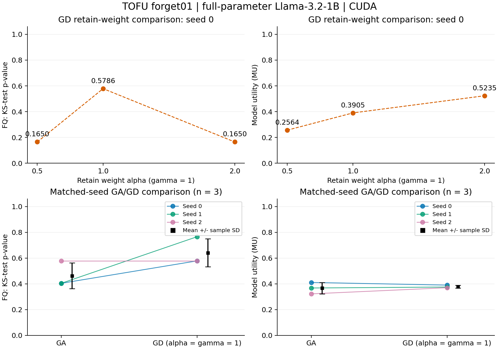

# Phase-two verified results / 第二阶段核验结果

All six planned extensions and three CUDA controls passed independent CPU verification. Each complete evaluation has 657 questions; each training run has 10 updates and 320 sample visits.

计划中的六组扩展和三组 CUDA 对照均通过独立 CPU 核验。每组完整评估覆盖 657 题，每组训练完成 10 次更新和 320 次样本访问。

| Run / 实验 | FQ (KS p-value) | MU | Training seconds / 训练秒数 |
|---|---:|---:|---:|
| baseline-s0-cuda-v1 | 0.014302 | 0.599108 | — |
| ga-s0-cuda-v1 | 0.404587 | 0.410915 | 901.90 |
| gd-a1-s0-cuda-v1 | 0.578600 | 0.390496 | 894.72 |
| gd-a0p5-s0-cuda-v1 | 0.164973 | 0.256369 | 893.78 |
| gd-a2-s0-cuda-v1 | 0.164973 | 0.523458 | 887.35 |
| ga-s1-cuda-v1 | 0.404587 | 0.368063 | 857.72 |
| gd-a1-s1-cuda-v1 | 0.765931 | 0.375494 | 884.49 |
| ga-s2-cuda-v1 | 0.578600 | 0.322449 | 848.73 |
| gd-a1-s2-cuda-v1 | 0.578600 | 0.370063 | 866.48 |

| Method / 方法 | Metric / 指标 | n | Mean / 均值 | Sample SD / 样本标准差 |
|---|---|---:|---:|---:|
| GradAscent | forget_quality | 3 | 0.462592 | 0.100466 |
| GradAscent | model_utility | 3 | 0.367142 | 0.044240 |
| GradDiff | forget_quality | 3 | 0.641044 | 0.108156 |
| GradDiff | model_utility | 3 | 0.378684 | 0.010584 |

Across these three seeds, GA MU is 0.3671 +/- 0.0442 (sample SD), and GD MU is 0.3787 +/- 0.0106. GA has higher MU at seed 0; GD has higher MU at seeds 1 and 2. The observed average favors GD slightly, with less variation, but the ordering depends on seed and three runs do not establish a general advantage.

这三个种子中，GA 的 MU 为 0.3671 ± 0.0442，GD 为 0.3787 ± 0.0106（样本标准差）。seed 0 下 GA 的 MU 更高，seed 1、2 下 GD 更高。观测均值略偏向 GD，且 GD 波动较小，但排序依赖种子，三次实验不足以证明普遍优势。

At seed 0, increasing GD retain weight from 0.5 to 1 to 2 gives MU 0.2564, 0.3905, and 0.5235. FQ is 0.1650, 0.5786, and 0.1650 respectively. These observed points show that the metrics need not move together; the two equal FQ p-values do not imply identical checkpoints or answer distributions.

在 seed 0 下，GD 保留权重从 0.5 增至 1、2 时，MU 分别为 0.2564、0.3905、0.5235，FQ 分别为 0.1650、0.5786、0.1650。这些观测点说明两项指标未必同步变化；两个相同的 FQ p 值不代表检查点或回答分布相同。

The seed summaries include seeds 0, 1, and 2 on the Dell only. Weight comparisons fix seed 0 and gamma=1. Same-seed sampling matches across methods and weights, while the three seeds have distinct traces. All checkpoints are distinct and passed fresh-process reload checks.

种子汇总仅使用戴尔上的 seed 0、1、2。权重比较固定 seed 0 和 gamma=1。同种子的方法和权重比较使用一致采样，三个种子的轨迹互不相同。各检查点均不同，并通过新进程重载检查。

FQ is a KS-test p-value, not accuracy or a percentage forgotten. Its three-seed mean is descriptive, not a combined hypothesis test. Three seeds and three observed weight points do not establish a general ranking or a continuous trade-off curve. Mac runs remain separate. Prompt robustness and new methods are phase-three work.

FQ 是 KS 检验的 p 值，不是准确率或遗忘百分比。三个种子的均值仅作描述，不是合并后的假设检验。三个种子和三个已观测权重点不足以建立普遍方法排名或连续权衡曲线。Mac 结果单独保留。提示鲁棒性与新方法属于第三阶段工作。

Evidence: `study/phase2/audit.json`, `results.csv`, `seed-summary.csv`, `paired-seed-differences.csv`, and each run's configuration, exact source snapshot, complete raw evaluation, and CPU verification report. Figures are available as PNG and PDF.

证据包括 `study/phase2/audit.json`、`results.csv`、`seed-summary.csv`、`paired-seed-differences.csv`，以及每组配置、精确源码快照、完整原始评价和 CPU 核验报告。图表提供 PNG 和 PDF。

For the next team handoff: B reviews the method/loss settings and supplies SimNPO code; C freezes prompt tests and annotation rules; D reviews all seed/weight results and the nine utility components; A schedules resource checks and inference after those inputs are ready. Zeliang authorized GitHub publication; team notifications remain with Zeliang.

下一步组内交接：B 复核方法与损失配置并提供 SimNPO 代码；C 冻结提示测试和标注规则；D 复核全部种子／权重结果及九项效用分量；相关输入就绪后，由 A 安排资源检查与推理。Zeliang 已授权发布到 GitHub，组员通知仍由 Zeliang 进行。
