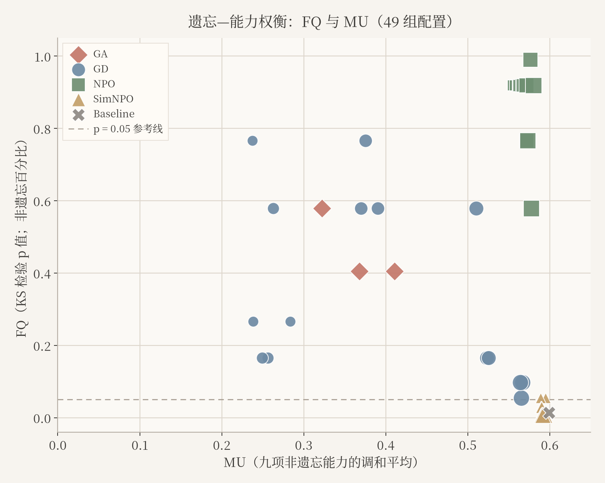

# LLM Unlearning: Forgetting, Utility, and Prompt Robustness

**English** | [简体中文](RESEARCH_REPORT.zh-CN.md) · [Project home](../README.md)

MSBD 5018 · Group 36 · Fall 2026 · Research synthesis updated 8 November 2026

## Abstract

We study the trade-off between targeted forgetting, retained model utility, and the reappearance of target facts under alternative prompts. Using the TOFU forget01 setting and a fixed TOFU-trained Llama-3.2-1B-Instruct checkpoint, we compare gradient ascent (GA), gradient difference (GD), negative preference optimization (NPO), and SimNPO. The completed grid contains 48 full-parameter training runs and one fixed baseline, 49 complete 657-question evaluations, and 15,680 prompt responses. NPO has high measured Forget Quality with moderate utility loss in this grid; SimNPO retains utility close to baseline but has low Forget Quality. GD is sensitive to the retain-loss weight. A separate, predominantly AI-assisted annotation subset records factual recovery under alternative prompts. These descriptive findings apply to the tested model, data, training budget, seeds, and coefficients; they do not establish universal method rankings or independently adjudicated human recovery rates.

## 1. Research questions and context

### Why unlearning requires more than deleting data

Machine unlearning seeks to reduce the influence of specified training data on an already trained model while preserving useful behavior on retained data. Removing a source record does not itself change the model's learned parameters. Training again without the forget set provides a conceptual reference, but repeating full training can be expensive. This motivates more targeted updates, whose effectiveness must be assessed against both forgetting and retention criteria ([Bourtoule et al., 2021](https://arxiv.org/abs/1912.03817); [Maini et al., 2024](https://arxiv.org/abs/2401.06121)).

For language models, a failed answer to one direct question is limited evidence: target information may still be elicited through a different prompt. Robust evaluation therefore needs to examine more than the original wording ([Lynch et al., 2024](https://arxiv.org/abs/2402.16835)). We organize our study around three complementary questions: whether target behavior changes, what useful behavior is lost, and whether alternative prompts recover a target fact. Our prompt tests are behavioral checks; they do not establish that information has been erased from the model's parameters.

### Selected research directions

The following is a focused map of related work, not an exhaustive taxonomy. Evaluation frameworks complement the algorithmic directions.

| Direction | Representative work | Relevance to this study |
|---|---|---|
| Training-time partitioning | SISA ([Bourtoule et al., 2021](https://arxiv.org/abs/1912.03817)) | Organizes training into isolated components so a removal request can trigger selective retraining. This requires a training-time design and is not a post-hoc baseline in our experiments. |
| Post-training objectives | GA/GD in [TOFU](https://arxiv.org/abs/2401.06121), [NPO](https://arxiv.org/abs/2404.05868), and [SimNPO](https://arxiv.org/abs/2410.07163) | Modify an existing checkpoint through forgetting and, where applicable, retention losses. These are the four methods evaluated here. |
| Representation intervention | RMU in [WMDP](https://proceedings.mlr.press/v235/li24bc.html) | Changes representations on forget data while constraining changes on retained data. It provides related-work context; we did not run RMU or the WMDP benchmark. |
| Evaluation and benchmarking | [TOFU](https://arxiv.org/abs/2401.06121), [robust unlearning tests](https://arxiv.org/abs/2402.16835), and [OpenUnlearning](https://arxiv.org/abs/2506.12618) | Supply controlled targets, complementary tests, and shared implementations of methods and metrics. They motivate examining forgetting, utility, and robustness together. |

### Why we chose this experimental scope

| Choice | Reason and question enabled |
|---|---|
| GA and GD | GA supplies a simple forgetting-only baseline. GD adds an explicit retain-loss term, allowing us to examine the effect of retention and its weight. |
| NPO and SimNPO | NPO uses a lower-bounded negative-preference objective relative to a fixed reference. SimNPO uses a reference-free, response-length-normalized formulation. This compares established formulations with different design choices; it is not a single-factor ablation of reference-model use. |
| TOFU forget01 | Fictitious author facts provide identifiable forgetting targets, retained facts, and a retain-only reference. This supports controlled measurement, rather than a claim about deletion of arbitrary real-world knowledge. |
| OpenUnlearning | A shared framework provides method implementations and evaluation definitions, with pinned versions and execution adaptations documented in this repository. |
| A 1B model and full-parameter updates | This is a project resource choice that allowed repeated runs on the available hardware. It supports a controlled grid, not conclusions about larger models. |

The method distinctions follow [NPO](https://arxiv.org/abs/2404.05868) and [SimNPO](https://arxiv.org/abs/2410.07163); the dataset and framework choices build on [TOFU](https://arxiv.org/abs/2401.06121) and [OpenUnlearning](https://arxiv.org/abs/2506.12618). The exact model size, ten-update budget, coefficients, and seeds are our course-project design choices, not settings prescribed by these papers. Sharing a budget does not match methods at equal achieved forgetting or make their loss scales equivalent.

### Research questions and contribution

Within this scope, we ask:

1. How do four unlearning objectives change forgetting and utility under a shared resource-constrained protocol?
2. How sensitive are the measured outcomes to retain-loss weight and random seed?
3. When a target fact is absent under direct questioning, can a different prompt elicit it again?

The algorithms are upstream methods; our contribution is resource adaptation, numerical and provenance checks, controlled experiments, prompt evaluation, and analysis. The project does not introduce a new unlearning objective. Our four prompt families do not reproduce the full eight-test suite of Lynch et al. or the relearning attacks studied in the SimNPO paper. The literature motivates the evaluation questions; the evidence for our findings comes from the completed runs and annotated subset described below.

## 2. Methods and experimental design

### Model, data, and controls

The fixed starting model is `open-unlearning/tofu_Llama-3.2-1B-Instruct_full`, revision `88e31200b97e4c0c04ae0d2f0b591f427046d192`. TOFU is pinned to revision `324592d84ae4f482ac7249b9285c2ecdb53e3a68`; the forgetting split is `forget01`. Full evaluations contain 40 forget, 400 retain, 100 real-author, and 117 world-fact questions. The retain-only Oracle is an imported reference, not a model retrained by this group. Exact source and license records are in [sources and notices](../THIRD_PARTY.md).

All 1,235,814,400 parameters are trainable; this is not LoRA. The documented execution environment is Windows with an RTX 4060 Laptop GPU (8 GB VRAM) and 16 GB system RAM. Formal runs use 10 optimizer updates and 320 sample visits (eight passes), learning rate 1e-5, microbatch size 4, accumulation 8, and sequence length 192. The CUDA adaptation uses sequential forget/retain backward passes where applicable and streamed optimizer state. Source snapshots and checks distinguish algorithm definitions from execution adaptations.

### Objectives and grid

GA maximizes the forget loss. GD combines a forgetting term with a retention term. NPO uses a fixed-reference negative-preference objective with a verified reference-NLL cache; SimNPO uses its simplified objective without that reference cache. The implemented losses and tests remain the executable definitions; see `npo_cuda.py`, `simnpo_cuda.py`, and the preserved upstream source.

| Setting | Seeds | Retain weight α | Training runs | Full evaluations |
|---|---|---|---:|---:|
| Baseline | Fixed starting checkpoint | Not applicable | 0 | 1 |
| GA | 0, 1, 2 | No retention term | 3 | 3 |
| GD | 0, 1, 2 per weight | 0.25, 0.5, 1, 2, 4 | 15 | 15 |
| NPO | 0, 1, 2 per weight | 0.25, 0.5, 1, 2, 4 | 15 | 15 |
| SimNPO | 0, 1, 2 per weight | 0.25, 0.5, 1, 2, 4 | 15 | 15 |
| **Total** | | | **48** | **49** |

GD/NPO use γ=1. NPO uses β=0.1; SimNPO uses γ=0.125, β=4.5, δ=0. These objectives have different scales and are not matched at equal achieved forgetting. Ten training runs were reused and 38 were newly executed for the complete grid. Historical Mac results and prompt pilots are separate evidence, not additional cells in this grid.

### Metrics and prompt protocol

Forget Quality (FQ) is a two-sided KS-test p-value comparing forget-set score distributions with the retain-only Oracle. A larger p-value is weaker evidence against the null distributional hypothesis, not a percentage of knowledge erased. Model Utility (MU) is the harmonic mean of nine components: probability, ROUGE-L recall, and truth ratio for retain, real-author, and world-fact domains. Neither MU nor ROUGE is factual accuracy.

Each setting produces 320 responses: 40 forget questions plus 40 fixed retain controls, each asked using Direct, Contextual, Role-play, and Instruction challenge prompts. The complete grid therefore has 49 × 320 = 15,680 responses. The annotation workbook covers a subset; its scope and exclusions are documented separately in [data and annotations](DATA_AND_ANNOTATIONS.md).

## 3. Results

At default coefficients (α=1 for methods with a retention term), the three-seed means and sample standard deviations are:

| Setting | FQ | MU |
|---|---:|---:|
| Baseline (one evaluation) | 0.014302 | 0.599108 |
| GA | 0.462592 ± 0.100466 | 0.367142 ± 0.044240 |
| GD | 0.641044 ± 0.108156 | 0.378684 ± 0.010584 |
| NPO | 0.918805 ± 0.000000 | 0.567208 ± 0.000786 |
| SimNPO | 0.005513 ± 0.002161 | 0.592088 ± 0.002791 |

NPO occupies a favorable measured forgetting–utility region in this finite grid. SimNPO retains utility close to baseline while the tested distribution remains distinguishable from the Oracle. GD utility increases from about 0.253 to 0.566 as α increases from 0.25 to 4, while its FQ is not monotonic. Seed variation is material for several settings. FQ means are descriptive summaries, not pooled significance tests; identical NPO p-values do not imply identical checkpoints.

The annotation analysis uses Q10–Q29, excluding Q23 and calibration rows in the primary statistics. For eligible cases where Baseline Direct is `yes` and the unlearned model's Direct is `no`, recorded alternative-prompt recovery is 16/328 for Contextual, 21/324 for Instruction challenge, and 35/320 for Role-play. `unclear` counts are reported separately and excluded from these denominators. Labels are predominantly AI-assisted with pilot checks; repeated questions across settings are not independent samples. These rates are supplementary descriptive evidence.

The [full evaluation chapter](evaluation/report/evaluation_metrics_and_results.md) contains all five tables, six main figures, two supplementary figures, captions, and metric definitions. The [49-setting CSV](../study/phase3/grid-20261029/all-49-settings.csv) and [three-seed summaries](../study/phase3/grid-20261029/three-seed-summary.csv) provide the numerical source of truth.

## 4. Reproducibility and evidence

The release retains configurations, raw answers, sampling traces, source snapshots, checkpoint hashes, verification reports, and plotting sources. Saved-record audits require no model inference. Full weights, runtime environments, caches, and credentials are excluded; a checkpoint hash alone does not make fresh training reproducible without the corresponding setup and licensed model access. See the [reproduction guide](REPRODUCIBILITY.md) for separate evidence, plotting, and GPU workflows.

## 5. Limitations

- One 1B model, TOFU forget01, three seeds, five weights, and a ten-update budget restrict external validity.
- FQ measures a distributional test outcome and does not prove complete factual erasure; utility can fall even when aggregate scores look favorable.
- The methods are not compared at equal achieved forgetting, and their coefficients have different scales.
- Annotation is a subset of generated responses and is mainly AI-assisted. Independent double-human annotation and disagreement adjudication are not established by this workbook.
- Retain annotation spot-checks cover only Q0, Q10, and Q20 and cannot substitute for full utility evaluation.
- Prompt recovery is conditional on direct-question outcomes; denominators vary by method and prompt, and repeated questions limit independence.
- Larger models, RMU, and wider hyperparameter searches are outside the completed scope.

## 6. Conclusion

Under the tested conditions, forgetting and utility respond differently to the objective and retain weight. NPO produces high FQ with less utility loss than GA and low-weight GD, while SimNPO preserves utility without comparable measured forgetting. Alternative prompts can recover some recorded target facts, motivating assessment beyond a single automatic score or direct question. The repository supplies the evidence needed to inspect these findings and clearly separates completed experiments from unverified human-review claims.

## Contributions and references

[Member contributions](TEAM_PROGRESS.md) distinguish research authorship from GitHub upload history. C (`top-linan`) authored the evaluation materials and refined the final figures; D (`xing-pangdingyu`) supplied the initial figures. Full source attribution and paper references are in [THIRD_PARTY.md](../THIRD_PARTY.md).
