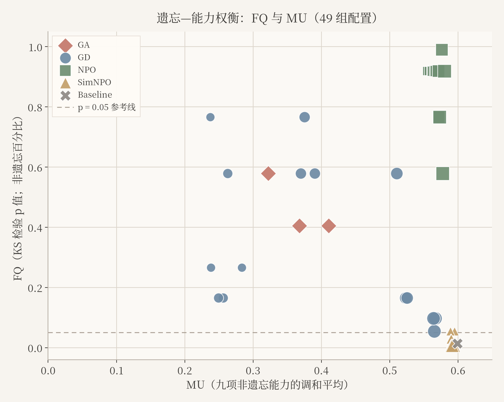

# 大模型遗忘学习：遗忘效果、能力保留与提示鲁棒性

[English](RESEARCH_REPORT.md) | **简体中文** · [项目首页](../README.zh-CN.md)

MSBD 5018 · 第 36 组 · 2026 年秋季 · 研究综合说明更新于 2026 年 11 月 8 日

## 摘要

本研究考察目标知识遗忘、模型效用保留以及替代提示下目标事实再次出现之间的关系。基于 TOFU forget01 和固定的 TOFU 训练版 Llama-3.2-1B-Instruct，比较梯度上升（GA）、梯度差分（GD）、NPO 与 SimNPO。完整矩阵包含 48 次全参数训练、一次固定基线、49 组各 657 题的完整评测，以及 15,680 条提示回答。在该矩阵内，NPO 的测得遗忘质量较高、效用损失适中；SimNPO 的效用接近基线，但遗忘质量较低；GD 对保留项权重较敏感。另一个主要使用 AI 辅助标注的子集记录了替代提示下的事实恢复。结论仅适用于所测试的模型、数据、训练预算、种子与系数，不代表方法的普遍排名，也不代表经独立人工裁决的恢复率。

## 1. 研究问题与背景

### 为什么遗忘学习不等于删除数据

机器遗忘旨在降低指定训练数据对已训练模型的影响，同时保留模型在其余数据上的有用行为。删除源数据不会自动改变模型已学到的参数。排除遗忘集后重新训练可作为概念参照，但重复完整训练通常成本较高，因此需要更有针对性的更新，并同时检验遗忘与保留效果（[Bourtoule 等，2021](https://arxiv.org/abs/1912.03817)；[Maini 等，2024](https://arxiv.org/abs/2401.06121)）。

对于语言模型，一次直接提问未得到答案，只能提供有限证据：换一种提示仍可能引出目标信息。因此，鲁棒性评估需要超出原始问法（[Lynch 等，2024](https://arxiv.org/abs/2402.16835)）。本研究围绕三个互补问题展开：目标行为是否改变、有用能力损失多少，以及替代提示能否恢复目标事实。提示测试属于行为检查，不能证明信息已从模型参数中彻底擦除。

### 相关研究方向

以下是与本项目有关的研究脉络，并非完整分类；评估框架与算法方向相互补充。

| 方向 | 代表工作 | 与本研究的关系 |
|---|---|---|
| 训练阶段的数据划分 | SISA（[Bourtoule 等，2021](https://arxiv.org/abs/1912.03817)） | 将训练组织为相互隔离的组成部分，在收到删除请求后选择性重训。它需要训练阶段的结构设计，不是本实验中的训练后遗忘基线。 |
| 训练后的目标函数更新 | [TOFU](https://arxiv.org/abs/2401.06121) 中的 GA/GD、[NPO](https://arxiv.org/abs/2404.05868)、[SimNPO](https://arxiv.org/abs/2410.07163) | 通过遗忘损失以及适用时的保留损失更新现有检查点，本项目实际比较这四种方法。 |
| 表征干预 | [WMDP](https://proceedings.mlr.press/v235/li24bc.html) 中的 RMU | 改变遗忘数据上的表征，同时约束保留数据上的变化。本项目仅将其作为相关工作，未运行 RMU 或 WMDP 基准。 |
| 评估与基准 | [TOFU](https://arxiv.org/abs/2401.06121)、[鲁棒遗忘测试](https://arxiv.org/abs/2402.16835)、[OpenUnlearning](https://arxiv.org/abs/2506.12618) | 提供可控目标、互补测试，以及方法与指标的统一实现，支持同时考察遗忘、效用与鲁棒性。 |

### 为什么选择这些方法与实验范围

| 选择 | 理由与可回答的问题 |
|---|---|
| GA 与 GD | GA 提供仅施加遗忘压力的简单基线；GD 增加显式保留损失，可考察保留项及其权重的影响。 |
| NPO 与 SimNPO | NPO 使用相对于固定参照的有下界负偏好目标；SimNPO 使用无需参照模型、按回答长度归一化的形式。两者比较的是具有不同设计选择的成熟方法，并非只改变是否使用参照模型的单因素消融。 |
| TOFU forget01 | 虚构作者事实提供可识别的遗忘目标、保留事实与仅保留数据参照，适合受控测量；它不等同于任意真实世界知识的删除场景。 |
| OpenUnlearning | 通过统一框架使用方法实现与评估定义，版本固定和执行适配均在本仓库记录。 |
| 1B 模型与全参数更新 | 这是基于项目资源的选择，使现有硬件能够完成多次重复实验，支持受控矩阵比较，但不能据此推断更大模型的表现。 |

方法差异依据 [NPO](https://arxiv.org/abs/2404.05868) 和 [SimNPO](https://arxiv.org/abs/2410.07163)，数据与框架选择依据 [TOFU](https://arxiv.org/abs/2401.06121) 和 [OpenUnlearning](https://arxiv.org/abs/2506.12618)。具体模型规模、十次更新预算、系数和种子是本课程项目的设计选择，并非这些论文规定的设置。共享训练预算也不意味着各方法达到相同实际遗忘水平，或目标函数具有相同尺度。

### 研究问题与贡献

在上述范围内，我们考察：

1. 在统一、受资源约束的协议下，四种目标函数如何改变遗忘与效用？
2. 结果对保留项权重和随机种子有多敏感？
3. 直接提问不能引出目标事实时，替代提示能否再次引出？

算法来自上游，本组贡献是资源适配、数值与来源核验、受控实验、提示评估和分析，并未提出新的遗忘目标函数。本项目的四类提示没有复现 Lynch 等工作的全部八项测试，也没有复现 SimNPO 论文中的再学习攻击。文献为评估问题提供依据；本项目结论的证据来自下文所述的已完成实验与标注子集。

## 2. 方法与实验设计

### 模型、数据与对照

固定起点为 `open-unlearning/tofu_Llama-3.2-1B-Instruct_full`，修订版 `88e31200b97e4c0c04ae0d2f0b591f427046d192`。TOFU 固定于 `324592d84ae4f482ac7249b9285c2ecdb53e3a68`，遗忘划分为 `forget01`。完整评测包含 40 道遗忘题、400 道保留题、100 道真实作者题和 117 道世界事实题。仅保留数据训练的 Oracle 是导入参照，不是本组重训模型。来源与许可见[来源说明](../THIRD_PARTY.md)。

全部 1,235,814,400 个参数参与训练，未使用 LoRA。记录的执行环境是 Windows、RTX 4060 Laptop GPU（8 GB 显存）和 16 GB 内存。每次正式训练包含 10 次优化器更新、320 次样本访问（八遍数据），学习率 1e-5、微批量 4、梯度累积 8、序列长度 192。CUDA 适配在适用方法中采用遗忘／保留顺序反向传播与流式优化器状态；源码快照区分算法定义与执行适配。

### 目标函数与矩阵

GA 最大化遗忘损失；GD 组合遗忘项与保留项；NPO 使用固定参照负偏好目标和已核验的参照 NLL 缓存；SimNPO 使用无需该缓存的简化目标。实际损失实现与测试是可执行定义，见 `npo_cuda.py`、`simnpo_cuda.py` 及保留的上游源码。

| 设置 | 随机种子 | 保留权重 α | 训练数 | 完整评测数 |
|---|---|---|---:|---:|
| Baseline | 固定起点 | 不适用 | 0 | 1 |
| GA | 0、1、2 | 无保留项 | 3 | 3 |
| GD | 每档 0、1、2 | 0.25、0.5、1、2、4 | 15 | 15 |
| NPO | 每档 0、1、2 | 0.25、0.5、1、2、4 | 15 | 15 |
| SimNPO | 每档 0、1、2 | 0.25、0.5、1、2、4 | 15 | 15 |
| **合计** | | | **48** | **49** |

GD/NPO 使用 γ=1；NPO 使用 β=0.1；SimNPO 使用 γ=0.125、β=4.5、δ=0。各目标尺度不同，也未匹配到相同的实际遗忘水平。完整矩阵复用 10 次训练、新增 38 次。历史 Mac 结果和提示 pilot 单独保存，不额外计入该矩阵。

### 指标与提示协议

遗忘质量 FQ 是遗忘集得分分布与仅保留数据 Oracle 分布之间双侧 KS 检验的 p 值。较大的 p 值表示反对零假设的证据较弱，不是知识被删除的百分比。模型效用 MU 是九项分量的调和平均值：保留、真实作者、世界事实三个领域各自的答案概率、ROUGE-L recall 与 truth ratio。MU 和 ROUGE 均不是事实正确率。

每组有 320 条回答：40 道遗忘题和 40 道固定保留对照，各使用 Direct、Contextual、Role-play、Instruction challenge 四类提示。共 49 × 320 = 15,680 条。标注表只覆盖其中一个子集，范围和排除规则见[数据与标注](DATA_AND_ANNOTATIONS.zh-CN.md)。

## 3. 结果

默认系数下（有保留项的方法 α=1），三个种子的均值与样本标准差如下：

| 设置 | FQ | MU |
|---|---:|---:|
| Baseline（一次评价） | 0.014302 | 0.599108 |
| GA | 0.462592 ± 0.100466 | 0.367142 ± 0.044240 |
| GD | 0.641044 ± 0.108156 | 0.378684 ± 0.010584 |
| NPO | 0.918805 ± 0.000000 | 0.567208 ± 0.000786 |
| SimNPO | 0.005513 ± 0.002161 | 0.592088 ± 0.002791 |

NPO 在有限矩阵中处于较有利的测得遗忘—效用区域。SimNPO 的效用接近基线，但其被检验的分布仍容易与 Oracle 区分。GD 的 α 从 0.25 增至 4 时，MU 从约 0.253 增至 0.566，FQ 则并不单调。部分设置存在明显种子波动。FQ 均值只是描述性汇总，不是合并显著性检验；NPO 相同的 p 值不意味着检查点相同。

标注分析覆盖 Q10–Q29，主统计排除 Q23 和校准记录。在 Baseline Direct 为 `yes`、遗忘后模型 Direct 为 `no` 的合格案例中，Contextual、Instruction challenge、Role-play 的记录恢复比例分别为 16/328、21/324、35/320。`unclear` 单列并排除在这些分母外。标签主要由 AI 辅助生成并经过试标核对；同题跨设置重复，不是独立样本。这些比例是补充性的描述证据。

[完整评估章节](evaluation/report/evaluation_metrics_and_results.zh-CN.md)包含五张表、六张主图、两张补充图、图注与指标定义。[49 组逐次 CSV](../study/phase3/grid-20261029/all-49-settings.csv)和[三种子汇总](../study/phase3/grid-20261029/three-seed-summary.csv)提供数值依据。

## 4. 可复现性与证据

仓库保留配置、原始回答、采样轨迹、源码快照、检查点哈希、核验报告和绘图源码。已存记录审计无需模型推理。完整权重、运行环境、缓存与凭证不进入仓库；仅有检查点哈希不能替代重新训练所需的环境与合规模型访问。证据核验、绘图与 GPU 工作流见[复现指南](REPRODUCIBILITY.zh-CN.md)。

## 5. 局限

- 单个 1B 模型、TOFU forget01、三个种子、五档权重与十次更新预算限制了推广范围。
- FQ 是分布检验结果，不证明事实被完整擦除；综合分数较好也可能掩盖分项能力下降。
- 各方法未在相同实际遗忘水平下比较，系数尺度也不同。
- 标注只覆盖生成回答的子集，主要采用 AI 辅助；工作簿不证明双人独立人工标注及分歧裁决已经完成。
- 保留集仅抽检 Q0、Q10、Q20，不能替代完整效用评测。
- 恢复率以直接提问结果为条件，不同方法、提示的分母不同；重复问题限制样本独立性。
- 更大模型、RMU 与更广的超参数搜索不属于已完成范围。

## 6. 结论

在当前条件下，遗忘与效用对目标函数和保留权重的响应不同。NPO 获得较高 FQ，效用损失小于 GA 和低权重 GD；SimNPO 保留效用，但没有同等的测得遗忘效果。替代提示可恢复部分记录中的目标事实，支持在单一自动分数与直接提问之外补充评估。仓库提供核查依据，并明确区分已完成实验与尚未证实的人工复核。

## 贡献与参考文献

[成员贡献](TEAM_PROGRESS.zh-CN.md)区分实际作者和 GitHub 上传记录。C（`top-linan`）负责评估材料与最终图表完善；D（`xing-pangdingyu`）提供初版图表。完整来源和论文参考见 [THIRD_PARTY.md](../THIRD_PARTY.md)。
