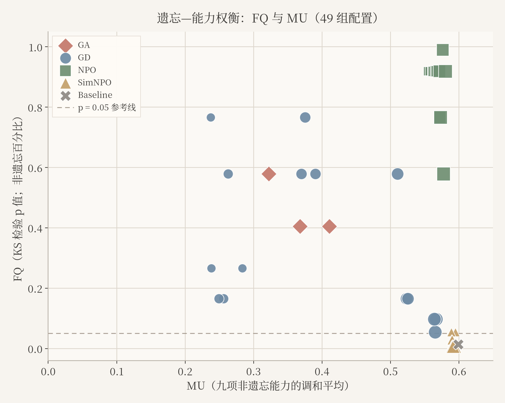
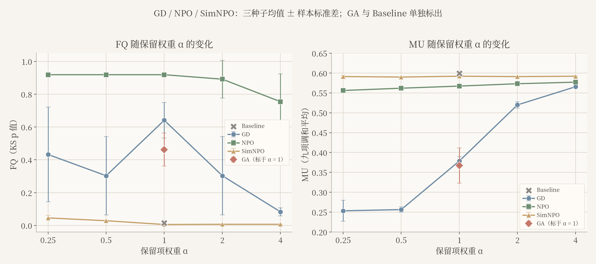
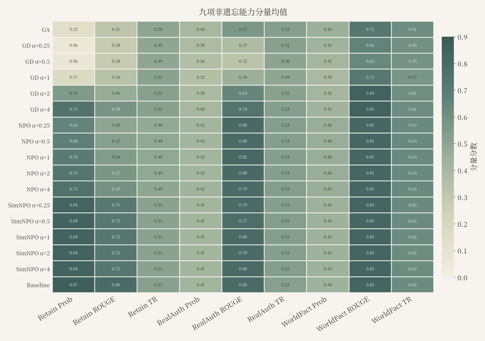
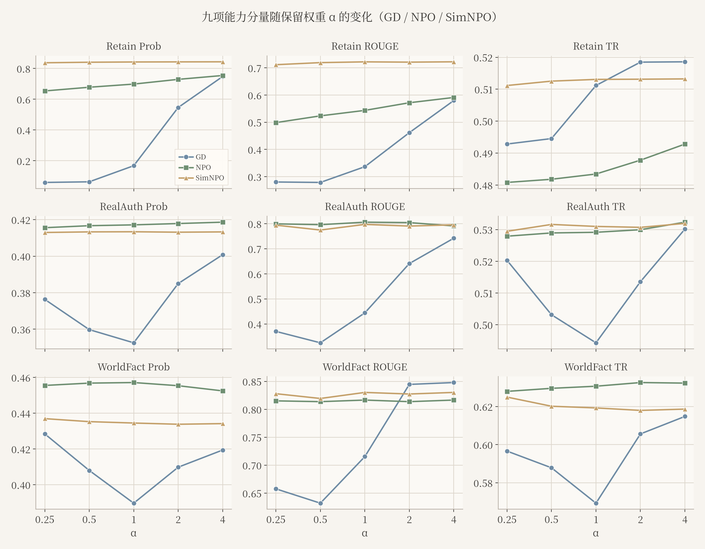
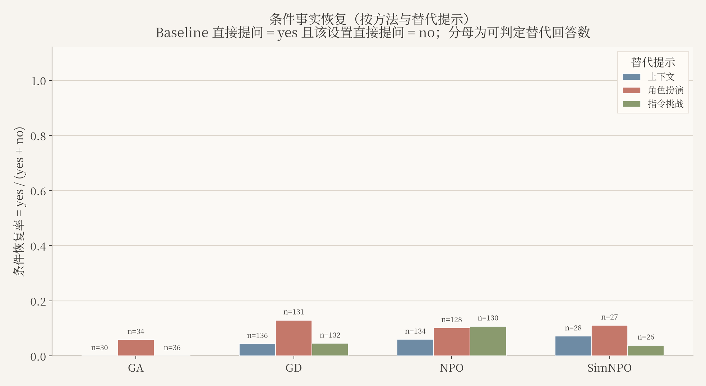
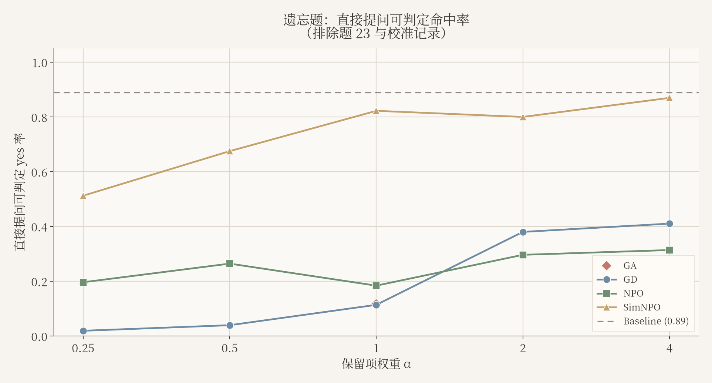

# 评价指标与实验结果

## 评价指标

本实验在 TOFU 基准与 OpenUnlearning 评测框架下，基于 Llama-3.2-1B 实施机器遗忘。评测包括自动指标，以及基于模型生成文本的事实标注；后者覆盖遗忘集问题 Q10–Q29，并对保留集问题 Q0、Q10 与 Q20 进行抽检。

遗忘质量（Forget Quality, FQ）定义为：将遗忘后模型在遗忘集上的得分分布，与仅在保留数据上训练得到的 Oracle 模型之对应分布进行双侧 Kolmogorov–Smirnov 检验所得的 \(p\) 值。FQ 度量既定检验下两分布的可区分程度：\(p\) 值越大，现有证据越不足以拒绝“两分布相同”的原假设。对各超参数组合，本文报告三个随机种子上的均值与样本标准差，用以描述重复实验中的变异；该汇总不构成将多次试验合并后的显著性检验。

模型效用（Model Utility, MU）定义为九项效用分量的调和平均值。九项分别对应保留集（Retain）、真实作者（Real Authors）与世界事实（World Facts）三类任务，每一类包含答案概率（Probability）、ROUGE-L 召回率与真值比率（Truth Ratio）。MU 用于综合衡量模型在非目标遗忘知识上的保持程度。

## 实验设置

对比方法为梯度上升（GradAscent, GA）、梯度差分（GradDiff, GD）、NPO 与 SimNPO，并以未经遗忘的基线模型（Baseline）作为参照。Baseline 评价一次；GA 在三个随机种子上各训练一次；GD、NPO 与 SimNPO 在保留项权重 \(\alpha \in \{0.25, 0.5, 1, 2, 4\}\) 上各进行三个随机种子的训练。合计 48 次正式训练与 1 次基线评价，共 49 组配置，每组均完成 657 题完整评测。

本轮仅改变保留项权重 \(\alpha\)，其余方法系数按预先声明保持固定：GD 与 NPO 取 \(\gamma = 1\)，SimNPO 取 \(\gamma = 0.125\)，NPO 取 \(\beta = 0.1\)，SimNPO 取 \(\beta = 4.5\)、\(\delta = 0\)。不同方法的损失尺度并不相同，实验亦未将各方法控制在相同的已实现遗忘水平上，因此方法间比较应在上述网格设定下解读。

## 自动评测结果

表 1 给出各方法在不同 \(\alpha\) 下 FQ 与 MU 的三种子均值及样本标准差。未经遗忘的 Baseline 的 FQ 为 0.014，MU 为 0.599。SimNPO 在全部 \(\alpha\) 取值下均保持较高的 MU（0.590–0.592），与 Baseline 接近，但其 FQ 始终较低（0.006–0.046）。NPO 在多数 \(\alpha\) 取值下获得较高的 FQ（当 \(\alpha \le 1\) 时，三种子均值均为 0.919），MU 介于 0.556 与 0.577 之间，低于 Baseline 与 SimNPO，但高于低 \(\alpha\) 设定下的 GD 以及 GA（MU = 0.367）。GD 的 MU 随 \(\alpha\) 增大而上升，由 \(\alpha = 0.25\) 时的 0.253 提高至 \(\alpha = 4\) 时的 0.566；当 \(\alpha \ge 2\) 时，GD 的 MU 高于 GA。与此同时，GD 在若干 \(\alpha\) 取值上、以及 NPO 在较高 \(\alpha\) 取值上，FQ 的样本标准差超过 0.1，表明相应配置对随机种子较为敏感。

**表 1.** 各方法在不同保留项权重下的 FQ 与 MU（三种子均值 ± 样本标准差；Baseline 仅评价一次）

| 方法 | \(\alpha\) | \(n\) | FQ | MU |
|---|---:|---:|---:|---:|
| GradAscent | 1 | 3 | 0.463 ± 0.100 | 0.367 ± 0.044 |
| GradDiff | 0.25 | 3 | 0.432 ± 0.289 | 0.253 ± 0.026 |
| GradDiff | 0.5 | 3 | 0.303 ± 0.239 | 0.256 ± 0.007 |
| GradDiff | 1 | 3 | 0.641 ± 0.108 | 0.379 ± 0.011 |
| GradDiff | 2 | 3 | 0.303 ± 0.239 | 0.520 ± 0.008 |
| GradDiff | 4 | 3 | 0.083 ± 0.025 | 0.566 ± 0.001 |
| NPO | 0.25 | 3 | 0.919 ± 0.000 | 0.556 ± 0.001 |
| NPO | 0.5 | 3 | 0.919 ± 0.000 | 0.562 ± 0.001 |
| NPO | 1 | 3 | 0.919 ± 0.000 | 0.567 ± 0.001 |
| NPO | 2 | 3 | 0.892 ± 0.114 | 0.573 ± 0.003 |
| NPO | 4 | 3 | 0.754 ± 0.170 | 0.577 ± 0.003 |
| SimNPO | 0.25 | 3 | 0.046 ± 0.015 | 0.591 ± 0.003 |
| SimNPO | 0.5 | 3 | 0.029 ± 0.000 | 0.590 ± 0.001 |
| SimNPO | 1 | 3 | 0.006 ± 0.002 | 0.592 ± 0.003 |
| SimNPO | 2 | 3 | 0.007 ± 0.000 | 0.591 ± 0.001 |
| SimNPO | 4 | 3 | 0.007 ± 0.000 | 0.592 ± 0.002 |
| Baseline | 1 | 1 | 0.014 | 0.599 |

图 1 给出全部 49 组配置在 MU–FQ 平面上的分布。NPO 主要位于较高 FQ 区域；SimNPO 集中于较高 MU、较低 FQ 的区域；GD 随 \(\alpha\) 增大沿效用轴右移；GA 位于中等 FQ、较低 MU 的位置。图 2 展示 GD、NPO 与 SimNPO 的 FQ、MU 随 \(\alpha\) 的变化（误差棒为三种子样本标准差），并将 GA 与 Baseline 标示于 \(\alpha = 1\)。图 3 与图 4 分别给出九项效用分量按方法与 \(\alpha\) 汇总的热力图及变化曲线：低 \(\alpha\) 的 GD 在保留集概率与 ROUGE 等分量上下降较为明显，而 SimNPO 各分量整体接近 Baseline。

## 事实标注结果

在遗忘集问题 Q10–Q29 上，对模型生成文本进行 yes / no / unclear 三类判定。直接提问的可判定命中率定义为 yes 占 yes 与 no 之和的比例。如表 2 所示，Baseline 的可判定命中率为 0.889；SimNPO 为 0.743，明显高于其余遗忘方法；NPO、GD 与 GA 分别为 0.252、0.181 与 0.118。

**表 2.** 遗忘集直接提问的判定统计与可判定命中率（Q10–Q29）

| 方法 | yes | no | unclear | 可判定命中率 |
|---|---:|---:|---:|---:|
| GradAscent | 6 | 45 | 6 | 0.118 |
| GradDiff | 43 | 194 | 44 | 0.181 |
| NPO | 65 | 193 | 25 | 0.252 |
| SimNPO | 165 | 57 | 63 | 0.743 |
| Baseline | 16 | 2 | 1 | 0.889 |

为考察提示形式变化是否能够重新引出目标事实，定义条件恢复率如下：选取 Baseline 在直接提问下判定为 yes、且遗忘后模型在直接提问下判定为 no 的问题，计算其在替代提示下被判定为 yes 的比例。替代提示包括上下文、角色扮演与指令挑战；分母为可判定样本数（yes 与 no 之和），unclear 另行统计。问题 23 因参考答案未提供具体性别信息，未纳入该项分析。

如表 3 所示，三种替代提示的总体条件恢复率分别为：上下文 0.049（16/328），指令挑战 0.065（21/324），角色扮演 0.109（35/320）。按方法与提示类型交叉统计见表 4。角色扮演提示的恢复率相对较高；GA 在上下文与指令挑战提示下未观察到可判定的恢复样本。部分单元的可判定样本量较小，相应比例仅作描述。图 5 与图 6 分别展示条件恢复率及直接提问可判定命中率随方法与 \(\alpha\) 的变化。

**表 3.** 条件恢复率（按替代提示汇总）

| 替代提示 | 恢复为 yes | 可判定样本数 | 条件恢复率 | unclear |
|---|---:|---:|---:|---:|
| 上下文 | 16 | 328 | 0.049 | 45 |
| 指令挑战 | 21 | 324 | 0.065 | 49 |
| 角色扮演 | 35 | 320 | 0.109 | 53 |

**表 4.** 条件恢复率（方法 × 替代提示）

| 方法 | 替代提示 | 恢复为 yes | 可判定样本数 | 条件恢复率 | unclear |
|---|---|---:|---:|---:|---:|
| GradAscent | 上下文 | 0 | 30 | 0.000 | 7 |
| GradAscent | 指令挑战 | 0 | 36 | 0.000 | 1 |
| GradAscent | 角色扮演 | 2 | 34 | 0.059 | 3 |
| GradDiff | 上下文 | 6 | 136 | 0.044 | 16 |
| GradDiff | 指令挑战 | 6 | 132 | 0.045 | 20 |
| GradDiff | 角色扮演 | 17 | 131 | 0.130 | 21 |
| NPO | 上下文 | 8 | 134 | 0.060 | 19 |
| NPO | 指令挑战 | 14 | 130 | 0.108 | 23 |
| NPO | 角色扮演 | 13 | 128 | 0.102 | 25 |
| SimNPO | 上下文 | 2 | 28 | 0.071 | 3 |
| SimNPO | 指令挑战 | 1 | 26 | 0.038 | 5 |
| SimNPO | 角色扮演 | 3 | 27 | 0.111 | 4 |

表 5 给出保留集抽检（Q0、Q10、Q20）在直接提问下的可判定命中率。该抽检仅覆盖三道保留题，用于辅助观察，不能替代 MU 所反映的整体效用。

**表 5.** 保留集抽检的直接提问判定统计（Q0、Q10、Q20）

| 方法 | yes | no | unclear | 可判定命中率 |
|---|---:|---:|---:|---:|
| GradAscent | 5 | 4 | 0 | 0.556 |
| GradDiff | 18 | 24 | 3 | 0.429 |
| NPO | 30 | 15 | 0 | 0.667 |
| SimNPO | 35 | 10 | 0 | 0.778 |
| Baseline | 2 | 1 | 0 | 0.667 |

上述标注以人工智能辅助标注为主，并经过试标核对，应作为自动指标之外的补充证据。

## 结果分析

综合自动评测与事实标注，可以得到以下观察。第一，SimNPO 在效用保持上最接近未经遗忘的基线，但 FQ 较低，表明其遗忘集得分分布仍较易与 Oracle 区分。第二，NPO 在本实验的分布检验上获得较高的 FQ，同时效用下降相对有限。第三，GD 的效用对保留项权重敏感：提高 \(\alpha\) 可使 MU 超过 GA，而过小的 \(\alpha\) 会明显损害效用；部分配置的 FQ 在不同种子间波动较大，报告相应结果时应同时给出均值与标准差。第四，在直接提问已相对基线未能给出目标事实的样本中，更换提示形式后仍可能重新引出该事实，说明除自动指标外，问法层面仍存在一定的信息残留。
