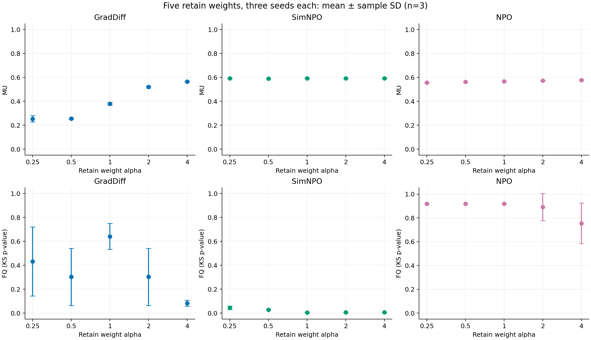
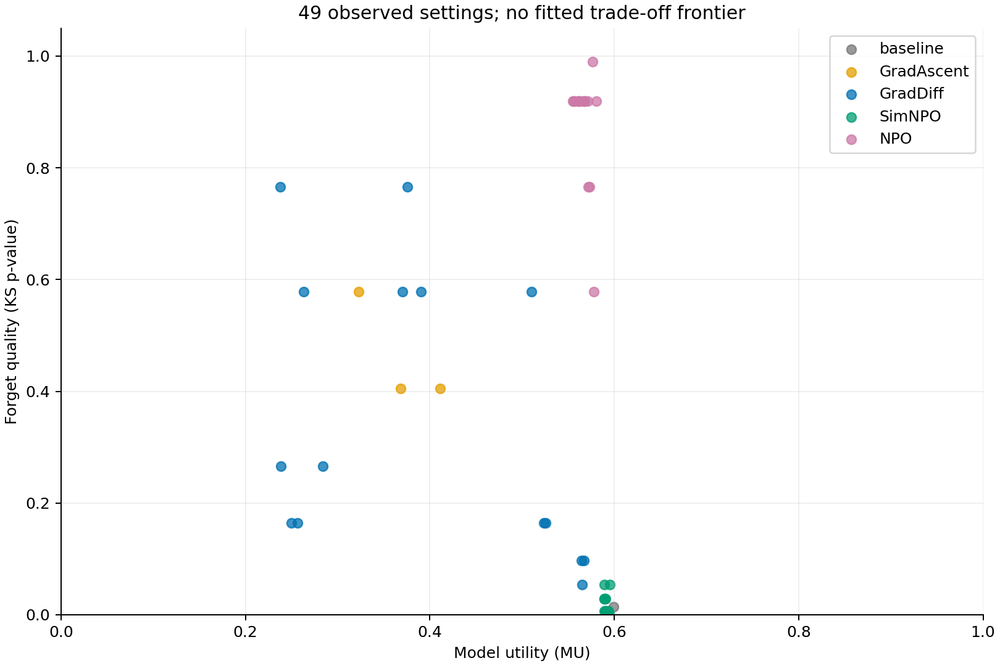
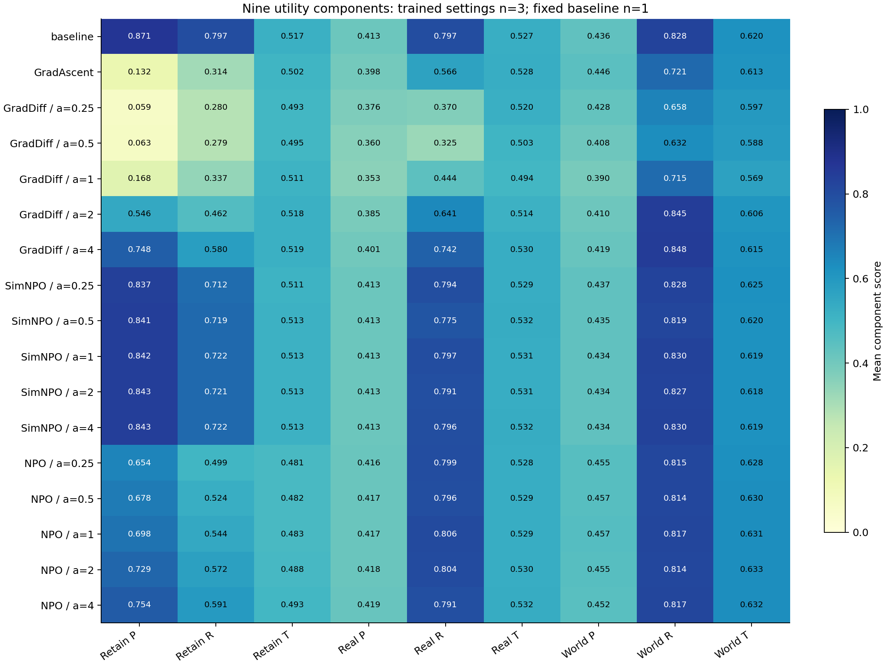
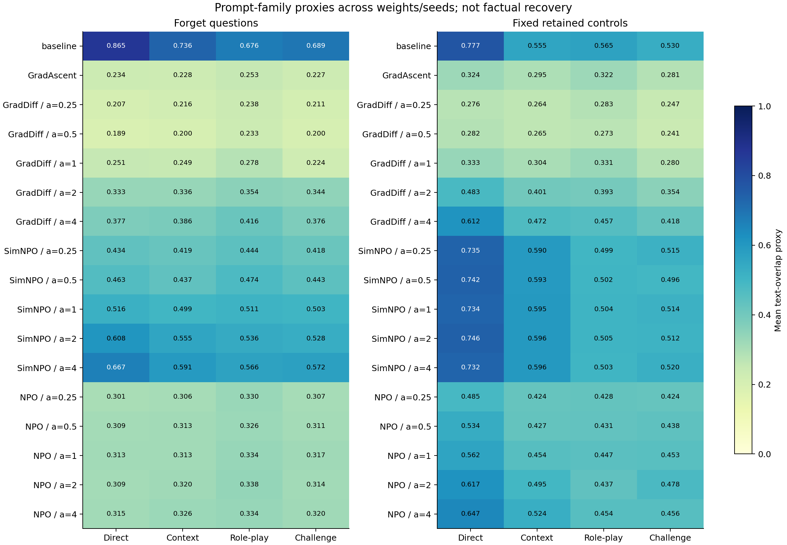

# Full weight/seed grid / 完整权重与种子矩阵

All 49 settings passed complete 657-question evaluation and checkpoint/source verification. This includes 48 formal training runs, ten updates / 320 visits each. Ten earlier formal runs were reused and 38 were newly trained. GD, SimNPO, and NPO each cover five retain weights × three seeds; GA covers three seeds; the fixed baseline is evaluated once.

全部 49 组配置完成 657 题评测及检查点、来源核验，含 48 次正式训练：复用原有 10 次，新增 38 次。GD、SimNPO、NPO 各完成五档保留权重×三个种子；GA 三个种子，固定起点只评价一次。每次训练十次更新、320 次访问，同 seed 配对采样一致。

## Three-seed summary / 三种子汇总

| Method | Retain alpha | n | FQ mean | FQ sample SD | MU mean | MU sample SD |
|---|---:|---:|---:|---:|---:|---:|
| GradAscent | 1 | 3 | 0.462592 | 0.100466 | 0.367142 | 0.044240 |
| GradDiff | 0.25 | 3 | 0.432435 | 0.288816 | 0.253269 | 0.026404 |
| GradDiff | 0.5 | 3 | 0.302849 | 0.238808 | 0.256302 | 0.006720 |
| GradDiff | 1 | 3 | 0.641044 | 0.108156 | 0.378684 | 0.010584 |
| GradDiff | 2 | 3 | 0.302849 | 0.238808 | 0.519839 | 0.008176 |
| GradDiff | 4 | 3 | 0.082764 | 0.024788 | 0.565535 | 0.001355 |
| NPO | 0.25 | 3 | 0.918805 | 0.000000 | 0.556110 | 0.001256 |
| NPO | 0.5 | 3 | 0.918805 | 0.000000 | 0.561899 | 0.000574 |
| NPO | 1 | 3 | 0.918805 | 0.000000 | 0.567208 | 0.000786 |
| NPO | 2 | 3 | 0.891585 | 0.114497 | 0.573144 | 0.002704 |
| NPO | 4 | 3 | 0.754446 | 0.170393 | 0.577085 | 0.003490 |
| SimNPO | 0.25 | 3 | 0.045628 | 0.014744 | 0.591207 | 0.003333 |
| SimNPO | 0.5 | 3 | 0.028603 | 0.000000 | 0.589954 | 0.000567 |
| SimNPO | 1 | 3 | 0.005513 | 0.002161 | 0.592088 | 0.002791 |
| SimNPO | 2 | 3 | 0.006761 | 0.000000 | 0.591106 | 0.001322 |
| SimNPO | 4 | 3 | 0.006761 | 0.000000 | 0.592051 | 0.001625 |
| baseline | 1 | 1 | 0.014302 |  | 0.599108 |  |

P / R / T label answer probability, ROUGE-L recall and truth ratio. All nine component means and sample SDs are in three-seed-summary.csv; the fixed baseline has n=1 and no estimated seed variability.

P / R / T 分别为答案概率、ROUGE-L recall 和 truth ratio。CSV 同时给出九项分量的均值和样本标准差；固定起点只有一次评价，不估算其种子波动。

FQ is a KS-test p-value, not a forgetting percentage; means and sample SDs describe three observed runs and are not a combined significance test. MU is a harmonic mean of nine non-forget components, not accuracy. Larger coefficients, a larger p-value, or a single aggregate score do not by themselves establish an optimal setting. These discrete points do not reproduce a continuous frontier. All settings, including poor results, are retained in all-49-settings.csv; all nine components and their per-weight seed summaries are included.

FQ 是 KS 检验 p 值，不是遗忘百分比；三次均值和样本标准差仅作描述，不是合并显著性检验。MU 是九项非遗忘分量的调和平均值，不是准确率。不能仅凭权重、p 值或一个综合分数决定最优；这些离散点不构成连续权衡前沿。包括不理想结果在内的全部配置、九项分量及其均值和波动均保留在 CSV 中。

## Controlled settings / 控制条件

Only retain alpha varies over 0.25/0.5/1/2/4. GD/NPO gamma=1; SimNPO gamma=0.125. NPO beta=0.1 with the fixed initial-reference cache; SimNPO beta=4.5, delta=0. The shared model/data/full-parameter budget and evaluation profile are fixed. Method-specific loss scales differ, and achieved forgetting is not matched. Parameter search is not exhaustive beyond this predeclared grid.

本轮只改变保留项 alpha，其他方法系数固定，模型、数据、全参数预算与评价协议一致。不同方法损失尺度不同，也没有控制为相同的已达成遗忘程度。本轮完整执行预先声明的有限矩阵，不声称穷尽所有超参数。

## Prompt outputs and human review / 提示与人工核验

Each of the 49 settings has 320 new outputs on the same frozen suite and common inference-runtime identity: 15,680 outputs in this series. Earlier 1,600 outputs and annotation files remain separate. prompt-proxy-summary.csv reports lexical overlap and answer length for all model/seed/weight/domain/family combinations. These are not human factual labels or factual-recovery rates.

49 组各有 320 条同套提示和相同推理源码身份下的新回答，共 15,680 条；原先 1,600 条回答和标注文件单独保留。CSV 覆盖每个模型、种子、权重、领域和问法的文本重合及回答长度。这些不是人工事实标签，也不能自动解释为事实恢复率。

paired-prompt-proxies.csv contains all 11,760 within-question changes from Direct to each alternative family; prompt-three-seed-summary.csv summarizes per-setting seed variability. Answer length and lexical phrasing can affect ROUGE, so these paired differences do not establish correct-fact recovery.

逐题配对 CSV 包含全部 11,760 个相对 Direct 的换问法变化，另附三种子代理均值和波动。回答长度和措辞会影响 ROUGE，配对文本重合变化仍不等于正确事实恢复。

Human reviewers must supply actual independent yes/no/unclear labels and resolve disagreements before factual-recovery conclusions are written. Human review status remains pending. Report figures require a final visual check before publication; the manifest describes numeric and source verification, not completed teammate review.

事实恢复结论仍需实际独立标签及分歧复核；人工核验状态保持待完成。图表发布前还需最终视觉检查，manifest 不代表组员已复核或标注完成。
