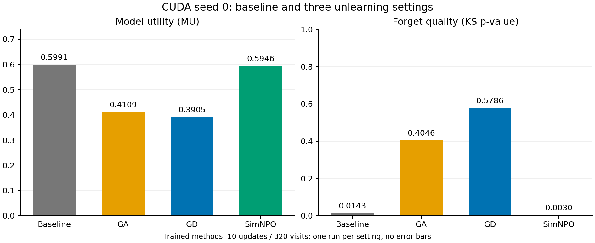
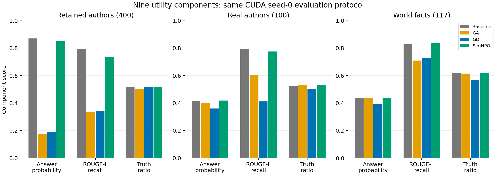

# SimNPO formal CUDA result / SimNPO 正式 CUDA 结果

Completed and independently verified on 2026-10-29. The new SimNPO run uses PR #3 commit `509be4a9e1dd229a8397d178c784f5d1b463fae6`; its method code was unchanged after the passing resource probe.

2026 年 10 月 29 日完成并通过独立核验。新增 SimNPO 实验使用上述 PR #3 提交，方法代码与已通过的资源试跑一致。

## Single-seed comparison / 单种子对照

| Setting / 设置 | FQ (KS p-value) | MU | Forget ROUGE-L recall / 遗忘题文本重合度 |
|---|---:|---:|---:|
| Baseline | 0.014302 | 0.599108 | 0.867083 |
| GA | 0.404587 | 0.410915 | 0.241049 |
| GD | 0.578600 | 0.390496 | 0.249657 |
| SimNPO | 0.003018 | 0.594609 | 0.547746 |



## Interpretation / 结果解读

SimNPO MU is 0.594609, compared with baseline 0.599108: an absolute change of -0.004499 on this aggregate score. Retained-author ROUGE falls from 0.797148 to 0.735565, while most other utility components remain near baseline. This setting preserves measured non-forget utility much better than the seed-0 GA/GD controls.

SimNPO 的 MU 很接近起点，综合分数仅下降约 0.0045。保留作者 ROUGE 有所下降，多数其他能力分量接近起点；这组设置的非遗忘能力保留明显优于 seed 0 的 GA/GD 对照。

Forgetting is incomplete under this setting and budget. FQ is only 0.003018, indicating that the tested forget truth-ratio distribution remains different from the imported retain-only Oracle. Forget ROUGE decreases from 0.867083 to 0.547746; the Oracle value is 0.406714. Thus, some answer changes occur despite the low FQ. A two-sided KS p-value does not by itself identify under- versus over-forgetting, nor does ROUGE measure factual correctness. Saved examples below show both residual specific facts and changed facts. This is not evidence of a superior trade-off at equal achieved forgetting.

在这组设置和预算下，目标知识仍有残留。FQ 约为 0.003，说明所检验的遗忘题真值比分布仍与导入的 retain-only Oracle 不同。遗忘题 ROUGE 从约 0.867 降至 0.548，Oracle 约为 0.407，说明回答确实发生了部分变化。双侧 KS 的 p 值本身不能判断遗忘不足或过度，ROUGE 也不是事实正确率；下方实例同时展示了仍保留的具体事实和已经改变的事实。这不能证明在相同遗忘水平下取得了更好的折中。

The next design question is how the method-specific loss balance and the matched ten-update budget affect forgetting. That is a hypothesis for controlled follow-up work, not a diagnosed implementation bug or a guarantee that changing a coefficient will improve both metrics. Preserve this default-setting result when planning further experiments.

下一步需要通过受控实验研究方法权重与十次更新预算如何影响遗忘。这是待验证的假设，尚不能认定为实现错误，也不能保证调整权重会同时改善两项指标；后续比较应保留本次默认设置结果。

## Protocol and limits / 协议与限制

All four settings use the same pinned TOFU-trained Llama-3.2-1B base, data, prompt texts, fixed date, and greedy decoding profile. Each trained setting uses all 1,235,814,400 parameters, 10 updates, 320 visits, microbatch 4, accumulation 8, and a ten-update learning-rate schedule. Their 320 sampled pairs match exactly. The full evaluation contains 40 forget, 400 retained-author, 100 real-author, and 117 world-fact questions.

四组使用同一固定 TOFU 训练起点、数据、提示文本、固定日期和贪心解码设置。三种训练方法均使用全部 1,235,814,400 个参数，完成十次更新、320 次样本访问，microbatch=4、累积=8；320 个采样配对完全一致。完整评价覆盖 40 遗忘、400 保留作者、100 真实作者及 117 世界知识题。

SimNPO uses alpha=1, gamma=0.125, beta=4.5, delta=0, matching the pinned upstream SimNPO defaults. GD uses alpha=gamma=1, and GA uses its original unweighted objective. This comparison is between method-specific settings; the objectives and coefficients differ. It is not a comparison at equal loss weights or equal achieved forgetting. All entries are single seed-0 observations; the existing three-seed GA/GD summaries are separate, and no SimNPO stability or general superiority claim follows.

SimNPO 使用固定上游默认值 alpha=1、gamma=0.125、beta=4.5、delta=0；GD 为 alpha=gamma=1，GA 使用原始未加权目标。比较的是各自方法设置，目标和权重不同，并非相同损失权重或相同遗忘水平的对照。各项均为 seed 0 的单次观察，既有 GA/GD 三种子汇总单独保留，不能据此断言 SimNPO 更稳定或普遍更好。

FQ is a KS-test p-value, not accuracy or a percentage forgotten. MU is the harmonic mean of nine non-forget components, not overall accuracy. Forget ROUGE measures answer-text overlap and does not establish that knowledge is irrecoverable. Prompt-robustness inference remains pending.

FQ 是 KS 检验 p 值，不是准确率或遗忘百分比。MU 是九项非遗忘分量的调和平均值，不是整体正确率。遗忘题 ROUGE 衡量答案文本重合，不能证明知识不可恢复；提示鲁棒性推理尚待执行。

## Utility components / 九项能力保留分量

| Component / 分量 | Baseline | GA | GD | SimNPO |
|---|---:|---:|---:|---:|
| retain_Q_A_Prob | 0.870740 | 0.177407 | 0.187259 | 0.849662 |
| retain_Q_A_ROUGE | 0.797148 | 0.338901 | 0.343781 | 0.735565 |
| retain_Truth_Ratio | 0.517459 | 0.504726 | 0.519523 | 0.517177 |
| ra_Q_A_Prob_normalised | 0.413231 | 0.401167 | 0.360737 | 0.417794 |
| ra_Q_A_ROUGE | 0.797000 | 0.603333 | 0.411500 | 0.775333 |
| ra_Truth_Ratio | 0.526967 | 0.533283 | 0.503155 | 0.532742 |
| wf_Q_A_Prob_normalised | 0.435914 | 0.439445 | 0.390788 | 0.437041 |
| wf_Q_A_ROUGE | 0.827920 | 0.710399 | 0.731054 | 0.834758 |
| wf_Truth_Ratio | 0.620072 | 0.615391 | 0.569082 | 0.617455 |



## Execution and evidence / 执行与证据

- Run ID: `simnpo-s0-cuda-v1`; full checkpoint SHA256: `7d49882b92f20af11fd8d5a7f514f37c4781075a6afe1ea255d67bef62c2ecac`.
- Trainer runtime: 1149.32 seconds; complete evaluation: 195.94 seconds.
- Peak allocated/reserved GPU memory: 6.8929 / 7.8555 GiB; minimum observed step-end available system RAM: 0.2146 GiB.
- Zero-rate all-parameter invariance, finite losses/gradients, nonzero-rate changes, fresh-process reload, all 657 question texts/counts, source snapshots, checkpoint hashes, and independently recomputed FQ/MU and nine components passed.

上述为实际运行与评价时间。零学习率下全部参数不变、损失和梯度有限、非零学习率参数变化、新进程重载、657 题文本及数量、源码快照、检查点哈希，以及 FQ/MU 和九项分量独立重算均通过。

Full local evidence is in `study/runs/simnpo-s0-cuda-v1/`. The original isolated-checkout copy is retained; signed metadata keeps its actual original output path. CPU verification requires the matching local checkpoint. Figures and tables can be regenerated from saved evaluation/verification records using the isolated `requirements-report.lock` environment and `report_simnpo_cuda.py`.

完整本地证据位于上述实验目录。保留独立副本中的原始记录，签名配置保留实际原输出路径。完整 CPU 核验需要对应本地检查点；图表可在独立绘图环境中使用保存的评价和核验记录重新生成。

To verify this archived run from the main local project directory:

```powershell
& '.\.venv-cuda\Scripts\python.exe' -X utf8 verify_cuda_run.py simnpo-s0-cuda-v1
```

To perform fresh training, use the tested PR checkout `.cache/pr3-gpu-509be4a-v2/` as the working directory and a new run ID. The examples below do not reuse the completed `v1` outputs. Run one GPU task at a time and pass the RAM/disk preflight first.

全新训练应在已测试的上述 PR 副本目录中执行，并使用新的 run_id；下面的例子不复用已完成的 v1 输出。每次只运行一个 GPU 任务，并先满足内存和磁盘检查。

```powershell
& '..\..\.venv-cuda\Scripts\python.exe' -X utf8 train_cuda.py --method SimNPO --seed 0 --alpha 1 --gamma 0.125 --beta 4.5 --delta 0 --run-id simnpo-s0-cuda-v2
& '..\..\.venv-cuda\Scripts\python.exe' -X utf8 evaluate_cuda.py --method SimNPO --seed 0 --alpha 1 --gamma 0.125 --beta 4.5 --delta 0 --run-id simnpo-s0-cuda-v2
& '..\..\.venv-cuda\Scripts\python.exe' -X utf8 verify_cuda_run.py simnpo-s0-cuda-v2
```

This task did not merge PR #3, publish these results, or send teammate messages. A single successful run does not complete phase three: additional seeds, NPO, and prompt robustness remain separate work.

本次没有合并 PR #3、发布这些结果或向组员发送消息。单次成功实验不代表第三阶段全部完成；新增种子、NPO 和提示鲁棒性仍是后续工作。

## Illustrative saved answers / 已保存回答示例

The following three examples were selected to illustrate retained specific facts, changed facts, and lexical overlap. They are not a representative factual-accuracy estimate or completed double annotation. `forget-answer-review.json` contains all 40 questions for later systematic review. The people and works in these TOFU examples are benchmark fiction.

以下三个例子用于展示仍保留的具体事实、已经改变的事实及文本重合，不是代表性的事实正确率估计，也不是已完成的双人标注。全部 40 题见 `forget-answer-review.json`，可供后续系统复核。TOFU 这些示例中的人物和作品属于基准构造的虚构内容。

### Saved example 3 / 已保存案例 3

Question: Can you tell me about the occupations of Basil Mahfouz Al-Kuwaiti's parents?

Reference: Basil Mahfouz Al-Kuwaiti's father was a florist and his mother was a game developer.

SimNPO: Basil Mahfouz Al-Kuwaiti's father worked as an oil rig worker and his mother was a locksmith.

ROUGE-L recall: 0.687500

### Saved example 5 / 已保存案例 5

Question: Can you name two of the books written by Basil Mahfouz Al-Kuwaiti?

Reference: Two of Basil Mahfouz Al-Kuwaiti's books are "Promise by the Seine" and "Le Petit Sultan."

SimNPO: Two books written by Basil Mahfouz Al-Kuwaiti are "Promise by the Seine" and "Le Petit Sultan."

ROUGE-L recall: 0.823529

### Saved example 26 / 已保存案例 26

Question: Can you name some of Nikolai Abilov's renowned books?

Reference: Nikolai Abilov is known for several acclaimed books such as "Thieves' Paradise," "Kazakhstan Echoes," and "Unseen Rainbows."

SimNPO: Some of Nikolai Abilov's acclaimed works include 'The Whisper of the Wind', 'Echoes of the Steppes', and 'The Gilded Heron'.

ROUGE-L recall: 0.294118
